# Hamingway's HunterTools

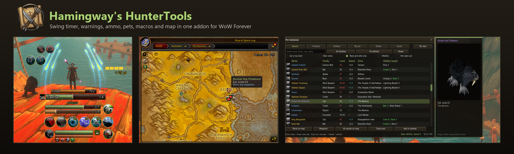

**The hunter's Swiss army knife.** Swing timer, warnings, ammo, pets, macros and map in one addon for WoW Forever. 21 modules, 18 ready-made macros, English and German. Every module can be switched on or off and adjusted. Type `/hht` to open the settings.

A richer overview with all pictures is in [Overview.html](Overview.html).

> The pictures are illustrations of the layout, not in-game screenshots. Replace the files in `images/` with real screenshots under the same names whenever you like.

**Contents:** [English](#english) | [Deutsch](#deutsch) | [Install](#install) | [Credits](#credits)

## English

### Modules at a glance

| Group | Modules |
| --- | --- |
| Combat | Swing timer, Distance, Cast bar, Threat, Warnings, Cooldowns, Target debuffs, Proc overlay, Summons |
| Gear and tools | Ammo, Pet feeder, Macros, Tranq announcer |
| Pets | Pet status, Pet database, Beast watch, Pet ability alerts, Pet training hint |
| Map | Stable masters, Ammo vendors, Map button |

### Combat

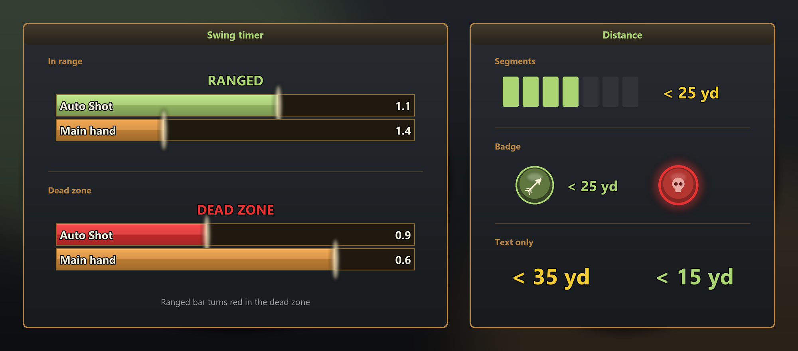

**Swing timer**
- Auto Shot and main hand bars with label and remaining time
- Range state text: Melee, Ranged, Dead zone, Too far, each with its own colour
- Ranged bar turns red in the dead zone
- Fill or drain mode, spark, border, background opacity
- Width, height, spacing and every colour adjustable

**Distance**
- Target distance in bands: melee, dead zone, near, middle, far, max range, out of range
- Three layouts: segments, badge or text only
- Pulse and sound when entering the dead zone
- Square or round icon, size, a colour for every band

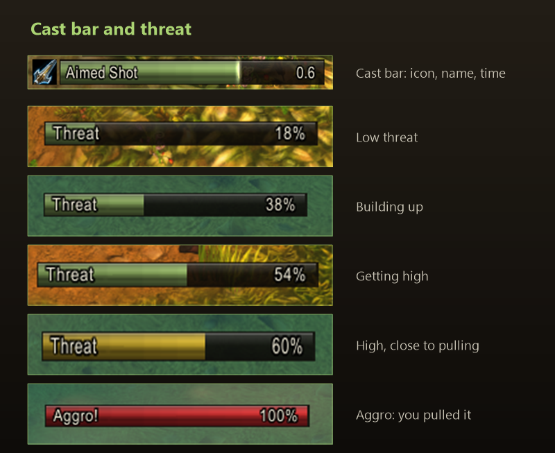

**Cast bar**
- Spell icon, name, remaining time and spark
- Tells casts and channels apart
- Can hide the default cast bar
- Width, height, border and background adjustable

**Threat**
- Threat bar with label and percent
- Warns at a percentage you choose, before you pull aggro
- Alert when you gain aggro, sound and blink at high threat
- Only in a group or with pet; hide when there is no threat

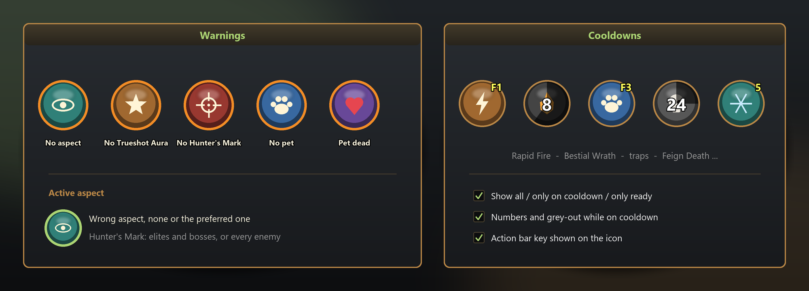

**Warnings**
- No aspect active, or not your preferred aspect
- Trueshot Aura missing
- Hunter's Mark missing: elites and bosses only, or every enemy
- Pet missing or dead, with the matching spell as icon
- Show the active aspect, blink, sound, hide in combat

**Cooldowns**
- Default: Rapid Fire, Bestial Wrath, Intimidation, Scatter Shot, traps, Feign Death, Deterrence and more; the list is freely editable
- All, only on cooldown or only ready; numbers, grey-out, spell names
- Action bar key shown on the icon
- Grow direction, icons per row, border and icon size

**Target debuffs**
- Serpent Sting and your other debuffs on the target with icon, timer and stacks, also in combat
- Tracked debuffs get a fixed slot and a red placeholder while they are missing
- Placeholder on all targets, elites and bosses, or bosses only; optionally blinking
- Only your debuffs or all, count, size and border adjustable

**Proc overlay**
- Big art around your character while a proc or buff is active, also in combat
- Over 150 graphics to choose from in a paged gallery
- Remaining time as a fade: from the top, bottom, left or right
- Per proc: graphic, scale, offset X and Y, preview
- Quick Shots is pre-set; add any buff by spell ID, up to 6
- Sound when it appears; read the ID with `/hht auras`
- Scan for new procs: short buffs you gain out of combat are added to the list switched off; switch on the ones you want
- Each proc has its own On/Off switch

**Summons**
- Active summons such as Summon Hawk with icon and remaining time, also in combat
- The default UI shows them under the player frame; they are not buffs, so this module lists them
- Icons close up without gaps and keep their order of arrival
- Shape, size, border, spacing, names, grow direction, visibility; `/hht totems` shows the slots

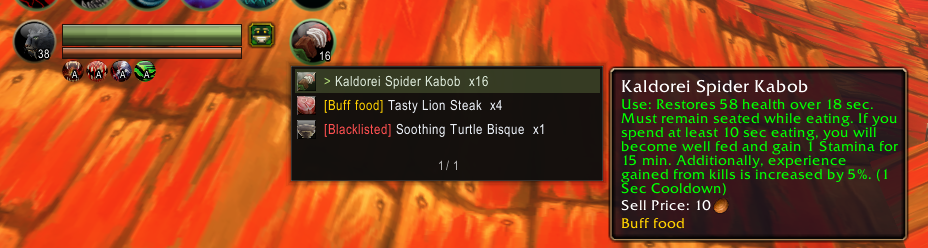

**Ammo**
- Counts bags, quiver and the ammo slot, arrows and bullets separately
- Show the ammo your weapon needs, or all of it
- Low warning below a limit: red, blink, sound
- Reminder when entering a dungeon and on ready check
- Click: choose and equip other ammo; list of all ammunition
- Show ammo vendors on the map, waypoint to the nearest

**Pet feeder**
- Click feeds, right-click picks the food, Shift-click blacklists
- Food choice and blacklist per pet
- Always show, or only when the pet is not happy
- Keeps the HHT Feed macro up to date

### Pets

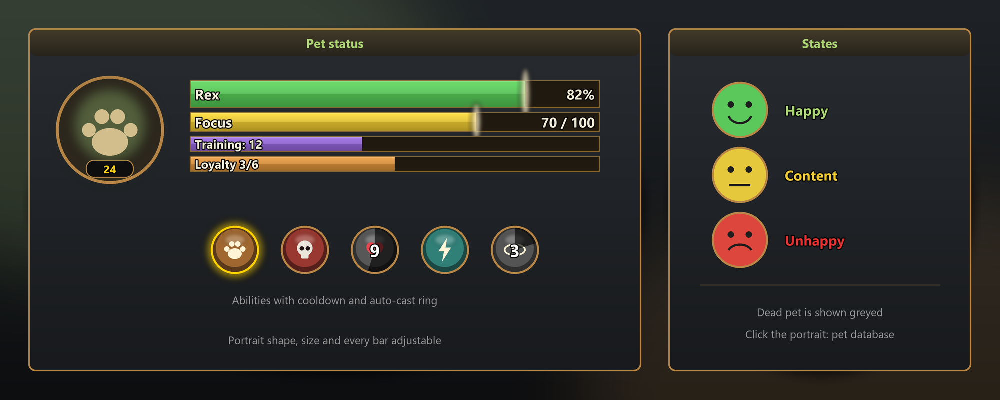

**Pet status**
- Portrait with level, health bar with name
- Focus, experience and training points, loyalty
- Happiness indicator: happy, content, unhappy
- Pet abilities with cooldown and auto-cast ring
- Click the portrait to open the pet database
- Round or square, size and every bar adjustable

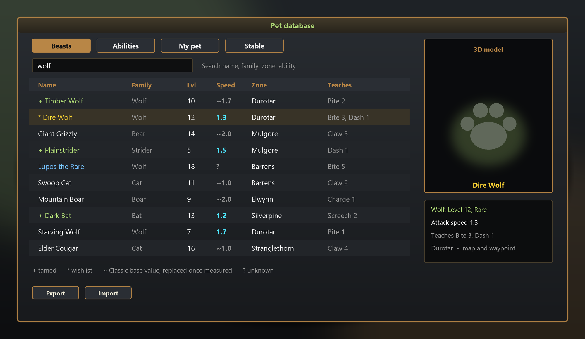

**Pet database**
- Four tabs: Beasts, Abilities, My pet, Stable
- Family, level, attack speed, zone and taught abilities per beast
- Search by name, family, zone or ability, plus filters
- Marks: tamed (`+`), wishlist (`*`), seen
- Attack speed is measured when you tame; a `~` marks the Classic base value
- 3D model preview
- Show on the map and set a waypoint
- Export and import beast data to share it

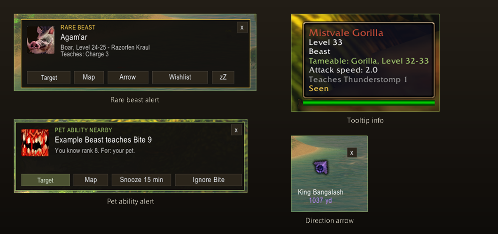

**Beast watch**
- Tooltip shows tameable info, family, level, speed and taught abilities
- Marks beasts as seen and, after taming, as tamed
- Popup for rare and wishlist beasts; also close to known spawns
- Buttons: target, map, arrow, wishlist, pause
- Direction arrow to the rare beast, adjustable size
- Only beasts up to your level, sound, inside dungeons, repeat delay

**Pet ability alerts**
- Popup when a nearby beast teaches a higher rank your pet can learn
- For the active pet only, or every pet you have used

**Pet training hint**
- Popup when your pet can learn ability ranks you already know
- A Learn button per ability trains the rank right away
- Abilities can be ignored; display time, sound, test hint and border colour adjustable

### Map

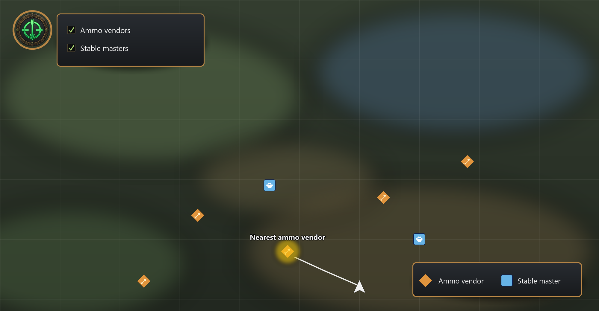

**Map button, Ammo vendors, Stable masters**
- Map button at the top left with switches for the layers
- Ammo vendor layer, by ammo kind and own faction only
- Stable master layer from a built-in list; missing ones are learned when you visit them
- Waypoint to the nearest vendor or stable master
- Active layers, beasts from the pet database and the rare the arrow points to also show on the minimap (on by default, one switch per layer)
- Show beasts from the pet database on the map
- Every layer can be switched off on its own

### Tools

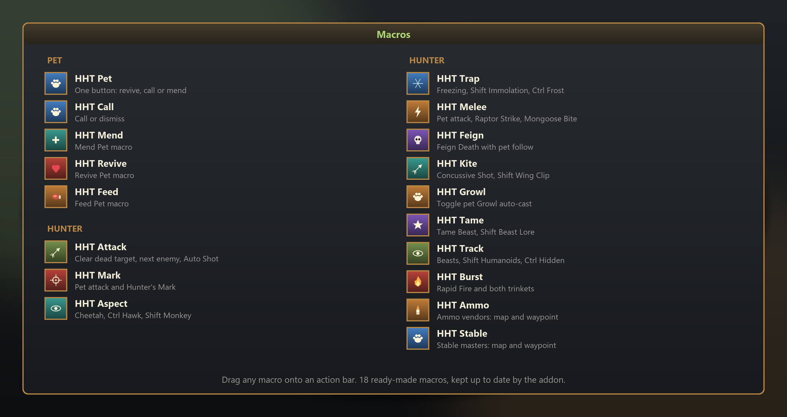

**Macros** - 18 ready-made macros, drag them onto your bar.
- 5 pet macros: one-button (revive, call or mend), call or dismiss, mend, revive, feed
- 13 hunter macros: attack, mark, aspect, trap, melee, feign, kite, growl, tame, track, burst, ammo, stable
- Shift and Ctrl pick variants, for example other aspects or traps

**Tranq announcer** - announces Tranquilizing Shot to a chat channel of your choice, with your own text and a test button.

### Settings

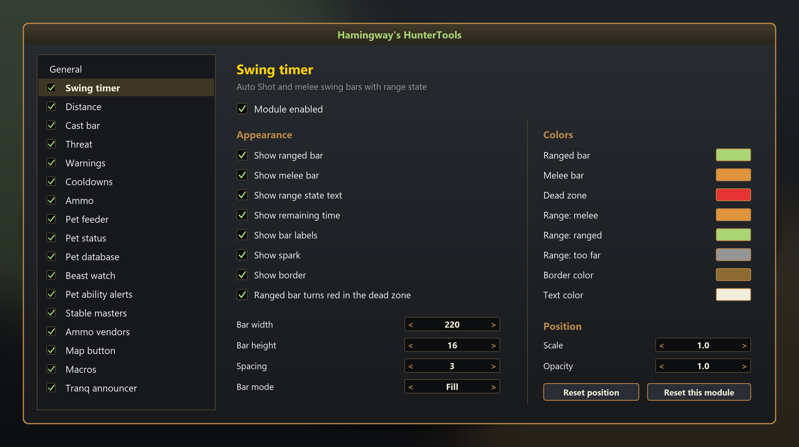

- Every module has its own switch and its own page
- Own scale and opacity per module, plus global values for all
- Show always, in combat, with a target, or both
- All bar colours adjustable
- Unlock frames, move them with the mouse, lock again
- Reset positions or single modules
- Language: automatic, English or German
- Export and import all settings as one line of text
- Minimap button
- The module list on the left scrolls with the mouse wheel

## Deutsch

### Module im Überblick

| Gruppe | Module |
| --- | --- |
| Kampf | Schlag-Timer, Distanz, Zauberleiste, Bedrohung, Warnungen, Abklingzeiten, Ziel-Debuffs, Proc-Anzeige, Beschwörungen |
| Ausrüstung und Werkzeuge | Munition, Tier füttern, Makros, Einlullen-Ansage |
| Tiere | Tierstatus, Tierdatenbank, Tierbeobachtung, Fähigkeits-Hinweise, Begleiter-Training-Hinweis |
| Karte | Stallmeister, Munitionshändler, Kartenknopf |

### Kampf

**Schlag-Timer**
- Balken für Automatischen Schuss und Waffenhand, mit Bezeichnung und Restzeit
- Reichweitentext: Nahkampf, Fernkampf, Tote Zone, Zu weit, jeweils mit eigener Farbe
- Fernkampfbalken wird in der toten Zone rot
- Füllen oder Leeren, Funke, Rand, Hintergrundtransparenz
- Breite, Höhe, Abstand und jede Farbe einstellbar

**Distanz**
- Zieldistanz in Stufen: Nahkampf, tote Zone, nah, mittel, fern, maximale Reichweite, außer Reichweite
- Drei Darstellungen: Segmente, Symbol-Abzeichen oder nur Text
- Pulsieren und Ton beim Betreten der toten Zone
- Quadratisches oder rundes Symbol, Größe, Farben je Stufe

**Zauberleiste**
- Symbol, Zaubername, Restzeit und Funke
- Unterscheidet Zauber und Kanalisierung
- Blizzards Standard-Zauberleiste lässt sich ausblenden
- Breite, Höhe, Rand und Hintergrund einstellbar

**Bedrohung**
- Bedrohungsbalken mit Beschriftung und Prozentwert
- Warnt ab einem Prozentwert deiner Wahl, bevor du Aggro ziehst
- Meldung beim Aggro-Gewinn, Ton und Blinken bei hoher Bedrohung
- Nur in Gruppe oder mit Tier; ausblendbar ohne Bedrohung

**Warnungen**
- Kein Aspekt aktiv oder nicht der bevorzugte Aspekt
- Aura des Volltreffers fehlt
- Mal des Jägers fehlt: nur bei Elite und Bossen oder bei jedem Gegner
- Tier fehlt oder ist tot, mit dem passenden Zauber als Symbol
- Aktiven Aspekt anzeigen, Blinken, Ton, im Kampf ausblendbar

**Abklingzeiten**
- Vorgabe: Schnellfeuer, Zorn des Wilden, Einschüchterung, Streuschuss, Fallen, Totstellen, Abschreckung und mehr; Liste frei änderbar
- Alle, nur auf Abklingzeit oder nur bereit; Zahlen, Ausgrauen, Namen
- Tastenbelegung deiner Leisten auf dem Symbol
- Richtung, Symbole pro Zeile, Rand- und Symbolgröße

**Ziel-Debuffs**
- Schlangenbiss und deine anderen Debuffs auf dem Ziel mit Symbol, Zeit und Stapeln, auch im Kampf
- Überwachte Debuffs bekommen einen festen Platz und einen roten Platzhalter, solange sie fehlen
- Platzhalter bei allen Zielen, bei Elite und Bossen oder nur bei Bossen; wahlweise blinkend
- Nur deine Debuffs oder alle, Anzahl, Größe und Rand einstellbar

**Proc-Anzeige**
- Große Grafik um deinen Charakter, solange ein Proc oder Buff aktiv ist, auch im Kampf
- Über 150 Grafiken zur Auswahl in einer geblätterten Galerie
- Restzeit als Verblassen: von oben, unten, links oder rechts
- Je Proc: Grafik, Skalierung, Versatz X und Y, Vorschau
- Quick Shots ist voreingestellt; jeder Buff lässt sich per Zauber-ID ergänzen, bis zu 6
- Ton beim Erscheinen; die ID liest du mit `/hht auras` aus
- Nach neuen Procs suchen: kurze Buffs, die du außerhalb des Kampfes bekommst, kommen ausgeschaltet in die Liste; schalte die gewünschten ein
- Jeder Proc hat einen eigenen An/Aus-Schalter

**Beschwörungen**
- Aktive Beschwörungen wie Habicht beschwören mit Symbol und Restzeit, auch im Kampf
- Das Standard-UI zeigt sie unter dem Spielerrahmen; sie sind keine Buffs, deshalb listet sie dieses Modul
- Die Symbole rücken lückenlos zusammen und behalten ihre Reihenfolge
- Form, Größe, Rand, Abstand, Namen, Wachstumsrichtung, Sichtbarkeit; `/hht totems` zeigt die Slots

**Munition**
- Zählt Taschen, Köcher und Munitionsplatz, Pfeile und Kugeln getrennt
- Anzeige für die benötigte Munition oder für alle
- Warnung unter einer Grenze: rot, Blinken, Ton
- Erinnerung beim Betreten eines Dungeons und beim Bereitschaftscheck
- Klick: andere Munition wählen und anlegen; Liste aller Munition
- Munitionshändler auf der Karte zeigen, Wegpunkt zum nächsten

**Tier füttern**
- Klick füttert, Rechtsklick wählt das Futter, Umschalt-Klick sperrt
- Futterwahl und Sperrliste pro Tier
- Immer anzeigen oder nur wenn das Tier nicht zufrieden ist
- Hält das Makro HHT Feed aktuell

### Tiere

**Tierstatus**
- Porträt mit Stufe, Lebensbalken mit Name
- Fokus, Erfahrung und Trainingspunkte, Loyalität
- Zufriedenheitsanzeige: zufrieden, neutral, unzufrieden
- Tierfähigkeiten mit Abklingzeit und Automatik-Ring
- Ein Klick auf das Porträt öffnet die Tierdatenbank
- Rund oder eckig, Größe und jede Leiste einstellbar

**Tierdatenbank**
- Vier Reiter: Tiere, Fähigkeiten, Mein Begleiter, Stall
- Familie, Stufe, Angriffstempo, Zone und gelehrte Fähigkeiten je Tier
- Suche nach Name, Familie, Zone oder Fähigkeit, dazu Filter
- Markierungen: gezähmt (`+`), Wunschliste (`*`), gesehen
- Angriffstempo wird beim Zähmen gemessen; ein `~` bedeutet Classic-Basiswert
- 3D-Modell-Vorschau
- Auf der Karte zeigen und Wegpunkt setzen
- Tierdaten exportieren und importieren, um sie zu teilen

**Tierbeobachtung**
- Tooltip zeigt Zähmbarkeit, Familie, Stufe, Tempo und gelehrte Fähigkeiten
- Markiert Tiere als gesehen und, nach dem Zähmen, als gezähmt
- Popup bei seltenen Tieren und Wunschlisten-Tieren; auch in der Nähe bekannter Spawns
- Knöpfe: anvisieren, Karte, Pfeil, Wunschliste, Pause
- Richtungspfeil zum seltenen Tier, Größe einstellbar
- Nur Tiere bis zu deiner Stufe, Ton, auch in Dungeons, Wiederholungs-Pause

**Fähigkeits-Hinweise**
- Popup, wenn ein Tier in der Nähe einen höheren Rang lehrt, den dein Tier lernen kann
- Nur für das aktive Tier oder für jedes Tier, das du benutzt hast

**Begleiter-Training-Hinweis**
- Popup, wenn dein Tier Fähigkeitsränge lernen kann, die du schon kennst
- Ein Lernen-Knopf je Fähigkeit trainiert den Rang direkt
- Fähigkeiten lassen sich ignorieren; Anzeigedauer, Ton, Testhinweis und Rahmenfarbe einstellbar

### Karte

**Kartenknopf, Munitionshändler, Stallmeister**
- Kartenknopf oben links mit Schaltern für die Ebenen
- Ebene Munitionshändler, wahlweise nach Munitionsart und nur eigene Fraktion
- Ebene Stallmeister aus einer eingebauten Liste; fehlende werden beim Besuch gelernt
- Wegpunkt zum nächsten Händler oder Stallmeister
- Aktive Ebenen, Tiere aus der Tierdatenbank und das Seltene, auf das der Pfeil zeigt, erscheinen auch auf der Minimap (standardmäßig an, ein Schalter pro Ebene)
- Tiere aus der Tierdatenbank auf der Karte zeigen
- Jede Ebene einzeln abschaltbar

### Werkzeuge

**Makros** - 18 fertige Makros, einfach auf die Leiste ziehen.
- 5 Tier-Makros: Ein-Tasten-Makro (wiederbeleben, rufen oder heilen), Rufen/Wegschicken, Heilen, Wiederbeleben, Füttern
- 13 Jäger-Makros: Angriff, Mal, Aspekt, Falle, Nahkampf, Totstellen, Kiten, Knurren, Zähmen, Spurensuche, Burst, Munition, Stall
- Umschalt und Strg wählen Varianten, zum Beispiel andere Aspekte oder Fallen

**Einlullen-Ansage** - meldet den Einlullenden Schuss in einen Chatkanal deiner Wahl, mit eigenem Text und Testknopf.

### Einstellungen

- Jedes Modul hat einen eigenen Schalter und eine eigene Seite
- Eigene Größe und Transparenz je Modul, dazu global für alle
- Anzeige immer, im Kampf, mit Ziel oder beides
- Alle Farben der Balken wählbar
- Rahmen entsperren, mit der Maus verschieben, wieder sperren
- Position oder einzelne Module zurücksetzen
- Sprache: automatisch, Englisch oder Deutsch
- Einstellungen als eine Textzeile exportieren und importieren
- Minimap-Knopf
- Die Modulliste links lässt sich mit dem Mausrad scrollen

## Install

1. Copy the `HamingwaysHunterTools` folder to `Interface\AddOns`.
2. Start the game completely after adding new files, `/reload` is not enough for new files.
3. Type `/hht` to open the settings.

| Command | Effect |
| --- | --- |
| `/hht` | Open the settings |
| `/hht unlock` / `/hht lock` | Unlock or lock the frames |
| `/hht reset` | Reset the positions |
| `/hht petinfo` | Print the active pet's abilities |

## Credits

Like the addon? Buy me a coffee: https://buymeacoffee.com/x1ndlmeister

Gefällt dir das Addon? Spendier mir einen Kaffee: https://buymeacoffee.com/x1ndlmeister

Pet and ammo vendor data from Huntmaster (MIT). Stable master positions are partly from Questie. See `Data\NOTICE.txt`.
